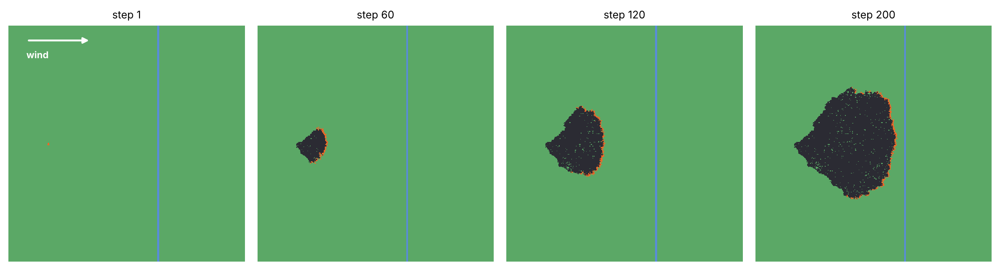
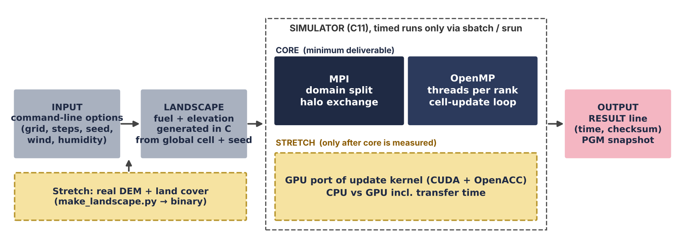
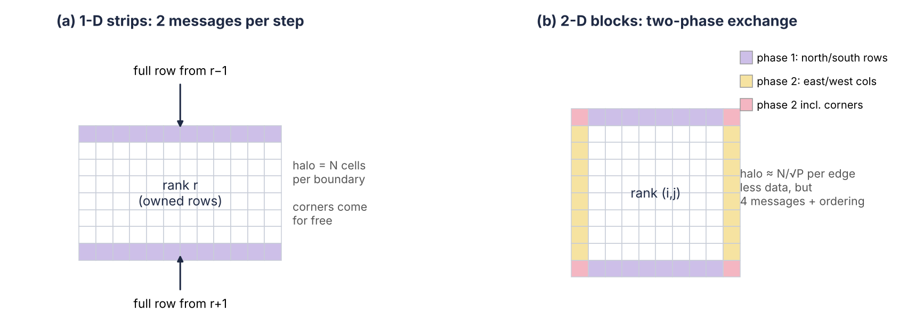
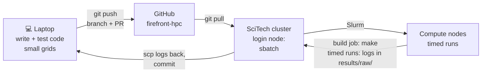
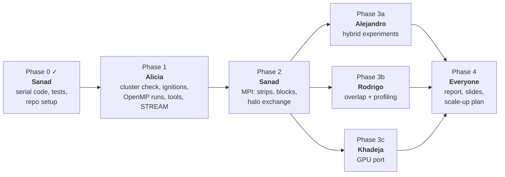

# FireFront-HPC

A parallel wildfire spread simulator. The fire is modelled as a cellular automaton on a raster grid, written in C and parallelized with MPI and OpenMP. A GPU port (CUDA, with OpenACC as a comparison) is our extra technology experiment. All timed runs go through Slurm on the SciTech HPC cluster.

This is our group project for the HPC course. The goal is not only a fast fire simulation, but to measure how each parallel technique changes performance and to explain why.

The full proposal, with all the details, is in [docs/proposal.pdf](docs/proposal.pdf). This README is the short version.

*Output of our serial C code (400×400 cells, default parameters, wind towards the east). The fire spreads mainly downwind and stops at the river (blue, fuel = 0). With a single ignition point most of the grid never burns, so timing runs will use 16 ignition points (`--ignitions 16`).*

---

## 1. The idea

Every cell of the grid is **unburnt**, **burning** or **burnt**. At each time step an unburnt cell can be ignited by any of its eight burning neighbours. A burning cell stays alight for B = 3 steps and then burns out.

Why HPC: going from 100 m to 25 m cells gives 16× more cells, and a useful forecast needs hundreds of weather scenarios, not one. 2025 was one of Spain's worst fire seasons, so the topic is current.

### Scope

| Tier | What | Covers |
|---|---|---|
| **Core** (must) | Serial baseline (done), MPI with strips and blocks, hybrid MPI + OpenMP, overlap optimization, profiling. Synthetic seeded landscape. | Baseline, 2 HPC approaches, scaling, sensitivity, optimization, bottleneck analysis |
| **Extra technology** (must, small) | Update kernel on the GPU in CUDA, OpenACC version to compare. Fallback if the GPU queue is blocked: OpenACC multicore vs OpenMP. | "Additional HPC technology"; a negative result is fine |
| **Stretch** | Tuned GPU version, real terrain (IGN / Copernicus), HDF5 output | Better report and EuroHPC case |

### Success metric

1. Every parallel version gives the **same checksum** as serial.
2. Experiments E1–E8 are complete and reproducible from [REPRODUCE.md](REPRODUCE.md).
3. The main bottleneck is explained with counter or timer evidence.

Performance target (a goal, not a condition): ≥ 60 % strong-scaling efficiency at 32 cores on the 8192² grid. (The student QOS allows at most 64 CPUs = 32 physical cores per user, see [env/cluster.md](env/cluster.md).)

---

## 2. The model (as implemented in `src/`)

| Item | Details |
|---|---|
| Grid | nx × ny cells (`--nx`, `--ny`; square N×N in the experiments) plus a one-cell border, so the same loop works for an MPI rank with neighbours |
| Per cell | 1 **state byte** (0 = unburnt, 1…B = burning for that many steps, 255 = burnt), fuel (float), elevation (float). State is double-buffered. ≈ 10 B/cell, so 8192² ≈ 0.7 GB |
| Neighbourhood | Moore (8 neighbours), halo of one cell |
| Update | **Dense**: every cell is visited every step, so work per rank is nearly uniform |
| Ignition | prob = p₀(1 − H) · fuel · f_wind / dist · f_slope (max 1) per burning neighbour; p = 1 − ∏(1 − prob) |
| Wind | f_wind = exp(c_w · V · (cos θ − 1)): 1 straight downwind, smaller otherwise |
| Slope | f_slope = exp(c_s · Δh / (dist · cell size)), Δh rounded to whole metres |
| Lookup tables | Wind and slope factors are pre-computed (`src/rules.h`), so there is no `exp()` in the cell loop |
| Defaults | p₀ = 0.8, B = 3, cell 25 m, V = 6 m/s towards the east, c_w = 0.25, c_s = 1.5, H = 0.2, seed 42, a 3-cell river at 63 % of the width. All except c_w and c_s (fixed in `src/params.c`) can be set on the command line, see [Build and run](#6-build-and-run) |
| Randomness | SplitMix64 hash of (seed, global cell, step), so results don't depend on ranks or threads |
| Landscape | Fuel and elevation are smooth noise generated from the **global** cell position and the seed, so each rank builds its own part without reading a file |
| Ignitions | Default: one 3×3 patch with its corner at (nx/6, ny/2); `--ignite X,Y` puts it at another cell. `--ignitions N` with N > 1 places N patches at positions drawn from the seed with the hash RNG, in global coordinates and never on the river (16 in timing runs). N = 1 keeps the old checksums |
| Output | One `RESULT key=value` line per run with `variant nx ny steps seed ranks threads t_total cells_per_s burning burnt checksum commit compiler ignitions places humidity`; with more than 20 steps the first 10 are an untimed warm-up; optional PGM snapshot (`--snapshot FILE`) |

**Checks** (`make test`): same seed → same result, burnt cells never decrease, a damp fire goes out, wind pushes the fire downwind, the fire does not cross the river, 16 ignitions burn more than 1. These are plausibility checks, not physical validation. `make test` also builds the OpenMP version and checks that 1, 2, 4 and 8 threads give the serial checksum (512×512, 100 steps, `--ignitions 16`); it prints `skipped` if the compiler has no OpenMP.

**Time step.** Timing runs fix the *number of steps*. For a fixed *simulated* time, 100 m → 25 m costs ≈ 64× more work (16× cells, ≈ 4× steps); that number is used in the EuroHPC scale-up plan.

---

## 3. HPC design

**MPI (to do).** The grid is split with `MPI_Cart_create`; blocking `MPI_Sendrecv` halo exchange first. We compare two decompositions:

- **Strips:** 2 messages per step, each a full row, so corners come for free.
- **Blocks:** smaller messages, but diagonal neighbours need the corner cells. **Two-phase exchange:** rows first, then columns one cell longer at each end (sent with `MPI_Type_vector`).
- The burnt area is combined with `MPI_Allreduce` only every 50 steps. A reduction every step would add a global sync and cancel the overlap optimization.

**OpenMP (code ready).** `#pragma omp parallel for schedule(static)` over rows. The landscape is initialised in a parallel loop with the same schedule (first touch). Locally, OpenMP gives the same checksum as serial. Still to do: run on the cluster with `OMP_PROC_BIND=close, OMP_PLACES=cores`.

**GPU (extra, to do).** CUDA kernel with the grid kept on the GPU between steps, plus an OpenACC version to compare. Timed with and without CPU↔GPU copies.

**Optimization (to do).** Overlap halo exchange with computation: post `MPI_Isend/Irecv`, update interior cells, then the boundary ring. Variant with `MPI_Test` calls, because many MPI libraries only move data inside MPI calls. If there is no gain, we show the timers that explain why.

**Floating point.** All CPU builds use `-ffp-contract=off`, so serial, OpenMP and MPI must match **bit for bit**. GPU: first try `nvcc --fmad=false` for an exact match, otherwise accept within 0.5 % burnt area.

---

## 4. Experiments (planned)

Grids cover the same 205 × 205 km area: **S** = 2048² (100 m), **M** = 4096² (50 m), **L** = 8192² (25 m). 400 steps per run, one repetition per job, median of 3 (5 for the optimization). Job scripts for E1 (`slurm/e1_baseline.sbatch`), the OpenMP part of E2 (`slurm/e2_omp_threads.sbatch`) and STREAM (`slurm/stream.sbatch`) are ready; the others follow with their code. The student QOS allows at most 64 CPUs = 32 physical cores per user at a time ([env/cluster.md](env/cluster.md)), so OpenMP runs use at most 32 cores and MPI runs at most 64 CPUs in total.

| # | Experiment | Configurations |
|---|---|---|
| E1 | Baseline | Serial, L grid, 1 core |
| E2 | Strong scaling | OpenMP 1, 2, 4, 8, 16, 32 threads on 32 physical cores, plus 64 threads on their hyper-threads (one job per repetition); MPI strips 1–32 ranks, also as 2 nodes × 16 cores (64-CPU user limit = 32 cores at most) |
| E3 | Hybrid split | 32 cores as different ranks × threads, on 1 node and on 2 nodes × 16 cores (64-CPU user limit) |
| E4 | Weak scaling | 1024² cells per core: 1 → 4 → 16 → 32 cores (the last as 2 nodes × 16 cores, grid 8192 × 4096; 64 cores exceed the 64-CPU user limit) |
| E5 | Decomposition | Strips vs blocks at 8, 16, 32 ranks (32 also as 2 nodes × 16 cores; 64-CPU user limit) |
| E6 | Resolution | S, M, L at 32 cores |
| E7 | Optimization | Blocking vs overlap (± `MPI_Test`) |
| E8 | Profiling | `perf` on 1 and 32 ranks |
| E9 | GPU | CUDA and OpenACC vs best 1-node CPU |
| E10 | STREAM + output | Node memory bandwidth; cost of the PGM snapshot |

**Roofline.** Counted in the code (`sim_step`), a cell far from the fire reads its state byte and its fuel (4 B) and writes one state byte: **6 B per update**, which covers about 98 % of the updates in our runs. Elevation (4 B more) is only read next to a burning cell. STREAM's bandwidth does not count write-allocate traffic, so neither do the 6 B, and the maximum is about **STREAM bandwidth / 6 B** cell updates per second. `python tools/roofline.py <GB/s>` prints this bound and two others: 7 B with write-allocate (compared with STREAM's real traffic, bandwidth × 4/3) and the older 10-B model, which our measurements exceed. On the cluster STREAM runs on the 32 cores we may use, so it gives the bandwidth available to 32 cores, not to the whole node, which is the right bound for E2 on the same cores. If measured throughput gets close to the bound, the kernel is memory-bound.

**Hypotheses.**
1. Memory bandwidth, not arithmetic, limits thread scaling.
2. A halo row of the L grid is only 8 KB, so communication is latency-bound and strips should beat blocks at our scale.
3. Overlap gains little unless MPI progress is forced.

---

## 5. Where the work happens

- **Code:** on GitHub, one branch per feature, pull request, reviewed by someone else before merging (see [CONTRIBUTING.md](CONTRIBUTING.md)).
- **Runs:** on the SciTech cluster through `sbatch`. Never run the simulator on the login node.

---

## 6. Build and run

    make                 # serial version -> build/firefront_serial
    make test            # model checks, command-line checks, OpenMP checksum vs serial
    make omp             # OpenMP version -> build/firefront_omp (needs gcc with OpenMP)
    make stream          # STREAM triad bandwidth benchmark -> build/stream (needs OpenMP)
    make clean           # remove build/

`make omp` needs gcc with OpenMP. On the cluster, load a GCC module first. On a Mac, `gcc` is Apple clang without OpenMP: install GCC with Homebrew and pass it explicitly, e.g. `make CC=gcc-16 omp`. The OpenMP test in `make test` takes its compiler from `OMP_CC` (default `gcc`), e.g. `OMP_CC=gcc-16 make test`. MPI and GPU targets will be added with their sources.

    ./build/firefront_serial --nx 1024 --ny 1024 --steps 200 --snapshot fire.pgm
    OMP_NUM_THREADS=4 ./build/firefront_omp --nx 1024 --ny 1024 --steps 200

| Option | Default |
|---|---|
| `--nx N`, `--ny N` | 1024 × 1024 (at least 4) |
| `--steps N` | 200 |
| `--seed N` | 42 |
| `--burn-steps N` | 3 (1–250) |
| `--wind-speed V` | 6 m/s |
| `--wind-dir DEG` | 0 (towards east, 90 = north) |
| `--humidity H` | 0.2 (0–1) |
| `--p0 P` | 0.8 |
| `--cell-size M` | 25 m |
| `--ignite X,Y` | corner of the 3×3 start patch, default (nx/6, ny/2); only with one ignition |
| `--ignitions N` | 1; N > 1 places N patches from the seed, off the river |
| `--river 0\|1` | 1 (firebreak on) |
| `--report-every N` | 0 (no progress lines) |
| `--snapshot FILE` | none (grey-scale PGM of the final state) |

`--help` prints this list. Each run prints one `RESULT` line; the `checksum` field must be the same for every version with the same options. See [REPRODUCE.md](REPRODUCE.md) for the cluster experiments.

### Repository layout

    src/        C sources of the simulator; src/bench for hardware benchmarks (STREAM done, ping-pong to do)
    tests/      correctness tests
    tools/      NumPy prototype, environment capture, log parsing and plotting scripts
    slurm/      job script templates
    env/        module versions (to fill in on the cluster) and Python requirements
    data/       notes on getting real terrain data
    results/    raw logs, CSV tables and figures (empty until the first cluster runs)
    docs/       proposal and images; report, scale-up plan and slides (to do)

---

## 7. Status

- [x] Project proposal ([docs/proposal.pdf](docs/proposal.pdf))
- [x] NumPy prototype of the fire rules
- [x] Serial baseline in C, with tests
- [x] OpenMP code, same checksum as serial locally
- [x] Slurm templates and environment capture script (MPI and GPU templates wait for their binaries)
- [x] Cluster check: 2 nodes with 2 × 128-core AMD EPYC 9755, 2 threads per core, 2 NUMA domains; modules and partitions in [env/cluster.md](env/cluster.md) and `env/modules.txt` (second node, julia, not yet checked)
- [x] Slurm scripts: 10 min, one repetition per job, build on a compute node (`slurm/build.sbatch`), node and NUMA logging; E1, E2 (OpenMP) and STREAM jobs within the student limits
- [x] `--ignitions N` option
- [x] Log parsing and plotting scripts (`tools/parse_logs.py`, `tools/make_plots.py`)
- [x] STREAM triad benchmark (`src/bench/stream.c`, `make stream`) and roofline bound (`tools/roofline.py`)
- [x] STREAM run on a cluster node (32 cores: 68 GB/s)
- [x] E1 baseline and OpenMP thread scaling on the cluster: serial 82 s (3.1 ns per cell update), 32 threads 3.24 s, efficiency 0.79; logs in `results/raw/`, table in `results/tables/all.csv`, figures in `results/figures/`
- [ ] Grid size sweep at 32 threads (`slurm/size_sweep.sbatch`)
- [ ] MPI version (strips, blocks, two-phase halo)
- [ ] Hybrid runs on 1 and 2 nodes
- [ ] Overlap optimization and profiling
- [ ] GPU port (CUDA + OpenACC)
- [ ] Report, EuroHPC scale-up plan and slides

---

## 8. Team and task order

| Phase | Who | Hand-over |
|---|---|---|
| 0 | Sanad | Done: serial simulator, tests, repo, Slurm templates |
| 1 | Alicia | Tag `v0.2-cluster`: E1 + thread-scaling logs, numbers in [docs/handover.md](docs/handover.md) |
| 2 | Sanad | Tag `v0.3-mpi`: same checksum as serial for every rank count; E2 + E5 logs |
| 3a | Alejandro | Hybrid E3, E4, E6 and the scaling figures |
| 3b | Rodrigo | Overlap optimization, E7, E8, bottleneck evidence |
| 3c | Khadeja | GPU kernel, E9, CPU vs GPU table |
| 4 | Everyone | Report, `REPRODUCE.md`, EuroHPC plan, slides (one per person) |

Nobody starts a phase until the previous tag passes the checksum test. Phase 3 names can be swapped. The full task lists are in section 9 of the proposal.

### Conventions

- **Results:** every run prints one `RESULT key=value` line. New fields go at the end, so old logs still parse.
- **Slurm:** parameters via `sbatch --export=ALL,NX=…`; logs to `results/raw/<name>_%j.out` with an environment snapshot; one repetition per job (`REP`), jobs ≤ 10 min, scripts build nothing (build with `sbatch slurm/build.sbatch` on a compute node first); timed jobs run one at a time (`--dependency=singleton`).
- **Reproducibility:** fixed seeds, module versions and flags in `env/`, commit hash in every `RESULT` line.

## Team

Sanad, Alejandro, Alicia, Rodrigo, Khadeja

## License

MIT, see [LICENSE](LICENSE).
