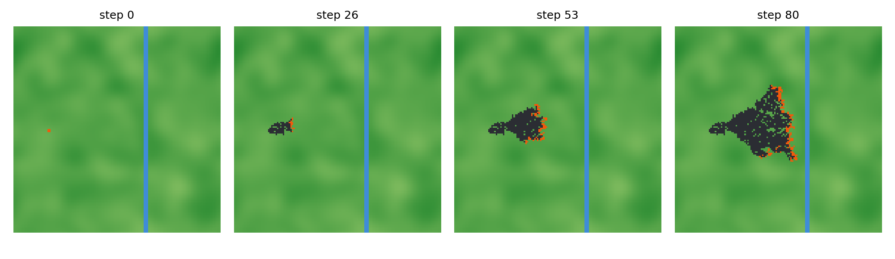

# FireFront-HPC

A parallel wildfire spread simulator. The fire is modelled as a cellular automaton on a raster grid, written in C and parallelized with MPI and OpenMP. A GPU port (CUDA, with OpenACC as a comparison) is the extra experiment. Everything is run through Slurm on the SciTech HPC cluster.

This is our group project for the HPC course. The point is not only to get a fast fire simulation, but to measure how each parallel technique changes performance and to explain why.

*Output of the small NumPy prototype (140x140 cells, wind blowing east, a river as firebreak). The C version will do the same on grids thousands of cells wide.*

## The model in short

Every cell of the grid is unburnt, burning or burnt. Each time step, an unburnt cell can be ignited by any of its eight neighbours that are burning. The chance depends on the fuel in the cell, the wind direction and speed, the slope between the two cells and the humidity. A cell stays alight for a fixed number of steps and then burns out.

This is a stencil computation: each cell only looks at its neighbours, does very little arithmetic and reads a few bytes of memory. That makes it a good test case for memory bandwidth, domain decomposition, hybrid MPI + OpenMP and GPU offloading. A finer grid also needs more time steps, so going from 100 m to 25 m cells costs about 64 times more work.

## Plan

| Part | Technology |
|---|---|
| Main implementation | C, MPI between subdomains, OpenMP inside each rank |
| Additional technology | CUDA kernel port (OpenACC for comparison), CPU vs GPU |
| Job submission | Slurm (`sbatch` / `srun`), 1 and 2 nodes |
| Experiments | serial baseline, strong and weak scaling, ranks x threads, strips vs blocks, resolution and weather scenarios |
| Profiling | own MPI timers, `perf`, `nvidia-smi` |
| Optimization | overlap of halo exchange with computation, compared before and after |
| Scale-up | estimate for a Spain-wide ensemble on a EuroHPC system |

## Repository layout

    src/        C sources of the simulator, src/bench for small hardware benchmarks
    tests/      correctness tests
    tools/      NumPy prototype, environment capture, log parsing and plotting scripts
    slurm/      job script templates
    env/        module versions and Python requirements
    data/       small inputs and notes on getting real terrain data
    results/    raw logs, CSV tables and figures
    docs/       report, scale-up plan, slides

## Build and run (serial version)

    make            # builds build/firefront_serial
    make test       # model checks and command line checks
    ./build/firefront_serial --nx 1024 --ny 1024 --steps 200 --snapshot fire.pgm

`./build/firefront_serial --help` lists all options (grid size, steps, seed, wind, humidity, ignition point, ...). The program prints one `RESULT` line with time, throughput, burnt cells and a checksum of the final grid. Two runs with the same options give the same checksum, which is how we will check the parallel versions later.

`make omp` builds the OpenMP version. It needs a compiler with OpenMP (on the cluster, `make CC=gcc omp` after loading the GCC module). It has not been run there yet.

## Status

- [x] Project proposal and design
- [x] NumPy prototype of the fire rules
- [x] Slurm templates and environment capture script
- [x] Serial baseline in C, with tests
- [ ] OpenMP version (code is prepared, still to be run and measured)
- [ ] MPI version (halo exchange, process grid)
- [ ] Hybrid runs on 1 and 2 nodes
- [ ] GPU port
- [ ] Scaling, profiling and optimization experiments
- [ ] Report, scale-up plan and slides

Build instructions and results will be added here as they exist. See [REPRODUCE.md](REPRODUCE.md) for how the main experiments will be repeated.

## Team

Sanad, Alejandro, Alicia, Rodrigo, Khadeja

## License

MIT, see [LICENSE](LICENSE).
