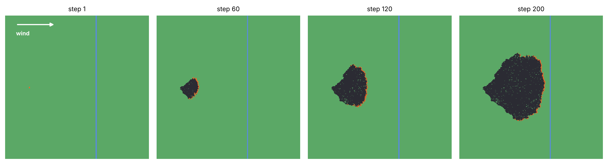
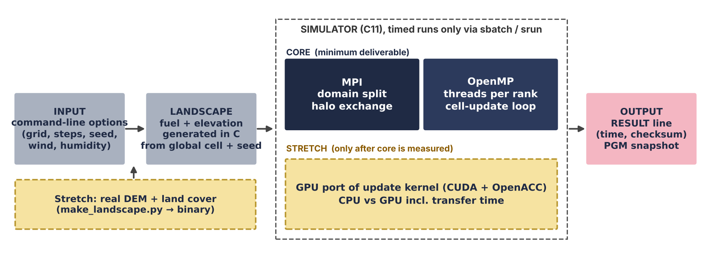
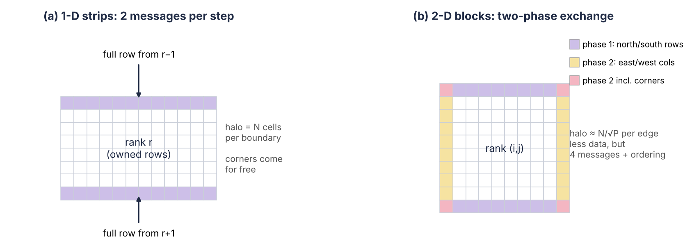
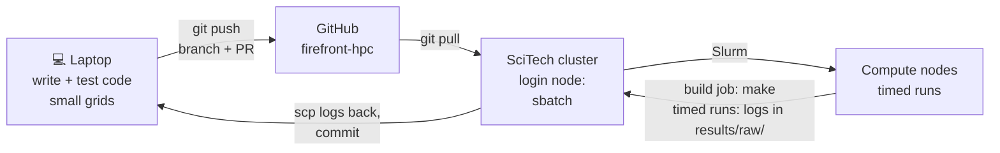
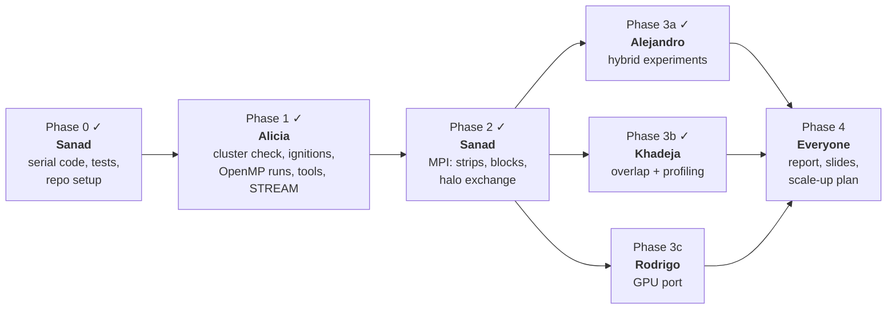

# FireFront-HPC

A parallel wildfire spread simulator. The fire is modelled as a cellular automaton on a raster grid, written in C and parallelized with MPI and OpenMP. A GPU port (CUDA, with OpenACC as a comparison) is our extra technology experiment. All timed runs go through Slurm on the SciTech HPC cluster.

This is our group project for the HPC course. The goal is not only a fast fire simulation, but to measure how each parallel technique changes performance and to explain why.

The full proposal, with all the details, is in [docs/proposal.pdf](docs/proposal.pdf). This README is the short version.

*Output of our serial C code (400×400 cells, default parameters, wind towards the east). The fire spreads mainly downwind and stops at the river (blue, fuel = 0). With a single ignition point most of the grid never burns, so timing runs will use 16 ignition points (`--ignitions 16`).*

---

## 1. The idea

Every cell of the grid is **unburnt**, **burning** or **burnt**. At each time step an unburnt cell can be ignited by any of its eight burning neighbours. A burning cell stays alight for B = 3 steps and then burns out.

Why HPC: going from 100 m to 25 m cells gives 16× more cells, and a useful forecast needs hundreds of weather scenarios, not one. 2025 was one of Spain's worst fire seasons, so the topic is current.

### Scope

| Tier | What | Covers |
|---|---|---|
| **Core** (must) | Serial baseline (done), MPI with strips and blocks, hybrid MPI + OpenMP, overlap optimization, profiling. Synthetic seeded landscape. | Baseline, 2 HPC approaches, scaling, sensitivity, optimization, bottleneck analysis |
| **Extra technology** (must, small) | Update kernel on the GPU in CUDA, OpenACC version to compare. Fallback if the GPU queue is blocked: OpenACC multicore vs OpenMP. | "Additional HPC technology"; a negative result is fine |
| **Stretch** | Tuned GPU version, real terrain (IGN / Copernicus), HDF5 output | Better report and EuroHPC case |

### Success metric

1. Every parallel version gives the **same checksum** as serial.
2. Experiments E1–E10 are complete and reproducible from [REPRODUCE.md](REPRODUCE.md).
3. The main bottleneck is explained with counter or timer evidence.

Performance target (a goal, not a condition): ≥ 60 % strong-scaling efficiency at 32 cores on the 8192² grid. (The student QOS allows at most 64 CPUs = 32 physical cores per user, see [env/cluster.md](env/cluster.md).)

---

## 2. The model (as implemented in `src/`)

| Item | Details |
|---|---|
| Grid | nx × ny cells (`--nx`, `--ny`; square N×N in the experiments) plus a one-cell border, so the same loop works for an MPI rank with neighbours |
| Per cell | 1 **state byte** (0 = unburnt, 1…B = burning for that many steps, 255 = burnt), fuel (float), elevation (float). State is double-buffered. ≈ 10 B/cell, so 8192² ≈ 0.7 GB |
| Neighbourhood | Moore (8 neighbours), halo of one cell |
| Update | **Dense** by default: every cell is visited every step, so work per rank is nearly uniform. With `--skip-tiles T` (E8) the block is cut into T × T tiles and a tile with no burning cell in or next to it is skipped; the result is the same |
| Ignition | prob = p₀(1 − H) · fuel · f_wind / dist · f_slope (max 1) per burning neighbour; p = 1 − ∏(1 − prob) |
| Wind | f_wind = exp(c_w · V · (cos θ − 1)): 1 straight downwind, smaller otherwise |
| Slope | f_slope = exp(c_s · Δh / (dist · cell size)), Δh rounded to whole metres |
| Lookup tables | Wind and slope factors are pre-computed (`src/rules.h`), so there is no `exp()` in the cell loop |
| Defaults | p₀ = 0.8, B = 3, cell 25 m, V = 6 m/s towards the east, c_w = 0.25, c_s = 1.5, H = 0.2, seed 42, a 3-cell river at 63 % of the width. All except c_w and c_s (fixed in `src/params.c`) can be set on the command line, see [Build and run](#6-build-and-run) |
| Randomness | SplitMix64 hash of (seed, global cell, step), so results don't depend on ranks or threads |
| Landscape | Fuel and elevation are smooth noise generated from the **global** cell position and the seed, so each rank builds its own part without reading a file |
| Ignitions | Default: one 3×3 patch with its corner at (nx/6, ny/2); `--ignite X,Y` puts it at another cell. `--ignitions N` with N > 1 places N patches at positions drawn from the seed with the hash RNG, in global coordinates and never on the river (16 in timing runs). N = 1 keeps the old checksums |
| Output | One `RESULT key=value` line per run with `variant nx ny steps seed ranks threads t_total cells_per_s burning burnt checksum commit compiler ignitions places humidity`, then the MPI fields `nodes decomp px py overlap t_halo t_compute t_reduce imbalance`, with `--overlap 1` also `t_post t_wait t_interior t_boundary`, then `skip_tiles active_tiles`, and in the GPU builds `t_kernel t_with_copies` (see [src/README.md](src/README.md)); with more than 20 steps the first 10 are an untimed warm-up; `t_total` is the slowest rank; optional PGM snapshot (`--snapshot FILE`, put together on rank 0 with MPI) |

**Checks** (`make test`): same seed → same result, burnt cells never decrease, a damp fire goes out, wind pushes the fire downwind, the fire does not cross the river, 16 ignitions burn more than 1. These are plausibility checks, not physical validation. `make test` also builds the OpenMP version and checks that 1, 2, 4 and 8 threads give the serial checksum (512×512, 100 steps, `--ignitions 16`); it prints `skipped` if the compiler has no OpenMP.

**Time step.** Timing runs fix the *number of steps*. For a fixed *simulated* time, 100 m → 25 m costs ≈ 64× more work (16× cells, ≈ 4× steps); that number is used in the EuroHPC scale-up plan.

---

## 3. HPC design

**MPI (done).** The grid is split with `MPI_Cart_create` (`src/decomp.c`); blocking `MPI_Sendrecv` halo exchange (`src/halo.c`). Every rank builds its own block of the landscape, uses global cell numbers for the random draws and keeps the elevation of its border cells, so any split gives exactly the serial result. We compare two decompositions (`--decomp strips|blocks`):

- **Strips:** 2 messages per step, each a full row, so corners come for free.
- **Blocks:** smaller messages, but diagonal neighbours need the corner cells. **Two-phase exchange:** rows first, then columns one cell longer at each end (sent with `MPI_Type_vector`).
- The burnt area is combined with `MPI_Allreduce` only every 50 steps. A reduction every step would add a global sync and cancel the overlap optimization.
- On the cluster all 51 E5 runs (1–32 ranks, 1 and 2 nodes) gave the serial checksum. Open MPI's default UCX layer crashed at start-up in some two-node runs, so the job scripts use `ob1` with shared memory and TCP (see [docs/handover.md](docs/handover.md)).

**OpenMP (done).** `#pragma omp parallel for schedule(static)` over rows. The landscape is initialised in a parallel loop with the same schedule (first touch). OpenMP gives the same checksum as serial; on the cluster it runs with `OMP_PROC_BIND=close`, `OMP_PLACES=cores`. In the MPI build every rank can use threads too (hybrid, E3).

**GPU (E10, code ready, cluster runs in progress).** CUDA kernel (`make cuda`) with the grid kept on the GPU between steps, plus an OpenACC version (`make acc`, and `make acc-mc` if the GPU queue is blocked). Both call the same cell rule as the CPU code (`src/update.h`). Timed with and without the CPU↔GPU copies. Cluster timings are added to the repo once the jobs in [REPRODUCE.md](REPRODUCE.md) have run.

**Optimization 1: overlap (E7, done).** `--overlap 1` posts non-blocking receives and sends for the rows, updates the interior cells, waits, sends the columns (they still carry the corners), waits, and then updates the boundary ring. Same checksum as blocking. Two nodes: 6–14 % faster; one node: between 5 % faster (4–8 ranks) and 5 % slower (32 ranks). The planned variant with `MPI_Test` calls during the interior update was not run.

**Optimization 2: tile skipping (E8, done).** `--skip-tiles T` skips tiles with no fire nearby; a skipped cell draws no random number, so the checksum does not change. Serial 60× faster, 32 MPI ranks 0.147 s. With MPI the bottleneck then moves to load imbalance: the ranks that hold the fire do all the work.

**Floating point.** All CPU builds use `-ffp-contract=off`, so serial, OpenMP and MPI must match **bit for bit**. GPU: first try `nvcc --fmad=false` for an exact match, otherwise accept within 0.5 % burnt area.

---

## 4. Experiments

Grids cover the same 205 × 205 km area: **S** = 2048² (100 m), **M** = 4096² (50 m), **L** = 8192² (25 m). 400 steps per run (the first 10 untimed), one repetition per job, median of 3 (5 pairs for E7). Every run must give the serial checksum before its time is used. Each experiment has its own job script in `slurm/`; the commands are in [REPRODUCE.md](REPRODUCE.md). The student QOS allows at most 64 CPUs = 32 physical cores per user at a time ([env/cluster.md](env/cluster.md)), so OpenMP runs use at most 32 cores and MPI runs at most 64 CPUs in total.

| # | Experiment | Configurations | Result (median of 3) |
|---|---|---|---|
| E1 | Baseline | Serial, L grid, 1 core | 81.95 s (3.1 ns per cell update) |
| E2 | Strong scaling | OpenMP 1–32 threads (+ 64 on hyper-threads); MPI 1–32 ranks | OpenMP 3.24 s at 32 threads (efficiency 0.79); MPI 2.62 s at 32 ranks (31×) |
| E3 | Hybrid split | 32 cores as 8 × 4, 16 × 2, 32 × 1 ranks × threads, 1 and 2 nodes | Best 2.69 s (8 × 4, one node); two nodes 14–23 % slower |
| E4 | Weak scaling | 1024² cells per core: 1 → 4 → 16 → 32 cores (the last as 2 nodes × 16 cores, grid 8192 × 4096) | Efficiency 0.87, 0.80 and 0.59 at 4, 16 and 32 cores |
| E5 | Decomposition | Strips vs blocks at 1–32 ranks, 1 and 2 nodes | Blocks slightly faster; two nodes: efficiency 0.47–0.60, halo exchange 43–56 % of the run |
| E6 | Resolution | 2048², 4096², 8192², 16384² at 32 threads | 7,800–8,200 MCUPS at every size: the kernel is compute-bound |
| E7 | Optimization: overlap | Blocking vs overlap, 4–32 ranks, 1 and 2 nodes (5 pairs) | Two nodes 6–14 % faster; one node between +5 % and −5 % |
| E8 | Optimization: tile skipping | `--skip-tiles T`: serial, 32 threads, MPI 8–32 ranks, T = 8–128 | Serial 60×; 32 ranks 0.147 s; MPI imbalance up to 3.2 |
| E9 | Profiling | Application and MPI timers (halo, compute, reduce, imbalance) in every run | Two nodes: exposed halo time; with E8: load imbalance. No hardware-counter run |
| E10 | GPU | CUDA and OpenACC vs best 32-core CPU run | In progress |
| — | Memory bandwidth | STREAM triad on 1–32 cores | 68 GB/s on 32 cores |

**Roofline.** Counted in the code (`sim_step`), a cell far from the fire reads its state byte and its fuel (4 B) and writes one state byte: **6 B per update**, which covers about 98 % of the updates in our runs. Elevation (4 B more) is only read next to a burning cell. STREAM's bandwidth does not count write-allocate traffic, so neither do the 6 B, and the maximum is about **STREAM bandwidth / 6 B** cell updates per second. `python tools/roofline.py <GB/s>` prints this bound and two others: 7 B with write-allocate (compared with STREAM's real traffic, bandwidth × 4/3) and the older 10-B model, which our measurements exceed. On the cluster STREAM runs on the 32 cores we may use, so it gives the bandwidth available to 32 cores, not to the whole node, which is the right bound for E2 on the same cores. If measured throughput gets close to the bound, the kernel is memory-bound.

**Hypotheses (from the proposal) and what we found.**
1. Memory bandwidth limits thread scaling. **Refuted:** throughput is the same whether the grid fits in cache or not (E6), at 71 % of the STREAM bound.
2. Strips beat blocks at our scale. **Refuted:** on one node blocks are a little faster at every rank count (E5).
3. Overlap gains little unless MPI progress is forced. **Partly:** without forcing progress, overlap still gave 6–14 % on two nodes; on one node it ranged from 5 % faster to 5 % slower (E7). The `MPI_Test` variant was not run.
4. Skipping tiles with no fire gives the largest speed-up. **Supported:** 60× on one core (E8); with MPI, load imbalance then limits it.
5. The GPU only wins if the grid stays on it. **Open** until the E10 runs are in.

---

## 5. Where the work happens

- **Code:** on GitHub, one branch per feature, pull request, reviewed by someone else before merging (see [CONTRIBUTING.md](CONTRIBUTING.md)).
- **Runs:** on the SciTech cluster through `sbatch`. Never run the simulator on the login node.

---

## 6. Build and run

    make                 # serial version -> build/firefront_serial
    make test            # model checks, command-line checks, OpenMP checksum vs serial
    make omp             # OpenMP version -> build/firefront_omp (needs gcc with OpenMP)
    make stream          # STREAM triad bandwidth benchmark -> build/stream (needs OpenMP)
    make mpi             # MPI + OpenMP version -> build/firefront_mpi (needs mpicc)
    make test-mpi        # MPI checks on 1-8 ranks: split, halo, checksum vs serial, snapshot
    make clean           # remove build/

`make omp` needs gcc with OpenMP. On the cluster, load a GCC module first. On a Mac, `gcc` is Apple clang without OpenMP: install GCC with Homebrew and pass it explicitly, e.g. `make CC=gcc-16 omp`. The OpenMP test in `make test` takes its compiler from `OMP_CC` (default `gcc`), e.g. `OMP_CC=gcc-16 make test`. `make mpi` uses `mpicc` with `-fopenmp`; on the cluster load `OpenMPI/4.1.6-GCC-13.2.0`. On a Mac: `brew install open-mpi`, then `OMPI_CC=gcc-16 make test-mpi` (with OpenMP) or `make test-mpi MPI_OMP=` (without). The GPU binaries are built on a cluster GPU node, not on the login node: `make cuda` (module `hpc-course-cuda/12.8.1`) and `make acc` / `make acc-mc` (module `nvhpc/25.7`). See [REPRODUCE.md](REPRODUCE.md).

    ./build/firefront_serial --nx 1024 --ny 1024 --steps 200 --snapshot fire.pgm
    OMP_NUM_THREADS=4 ./build/firefront_omp --nx 1024 --ny 1024 --steps 200
    OMP_NUM_THREADS=1 mpirun -np 4 ./build/firefront_mpi --nx 1024 --ny 1024 --steps 200 --decomp strips

| Option | Default |
|---|---|
| `--nx N`, `--ny N` | 1024 × 1024 (at least 4) |
| `--steps N` | 200 |
| `--seed N` | 42 |
| `--burn-steps N` | 3 (1–250) |
| `--wind-speed V` | 6 m/s |
| `--wind-dir DEG` | 0 (towards east, 90 = north) |
| `--humidity H` | 0.2 (0–1) |
| `--p0 P` | 0.8 |
| `--cell-size M` | 25 m |
| `--ignite X,Y` | corner of the 3×3 start patch, default (nx/6, ny/2); only with one ignition |
| `--ignitions N` | 1; N > 1 places N patches from the seed, off the river |
| `--river 0\|1` | 1 (firebreak on) |
| `--report-every N` | 0 (no progress lines) |
| `--snapshot FILE` | none (grey-scale PGM of the final state) |
| `--decomp strips\|blocks` | blocks (MPI only: how the grid is split over the ranks) |
| `--overlap 0\|1` | 0 (1 = overlap the halo exchange with the interior update, MPI only, E7) |
| `--skip-tiles N` | 0 = off; N > 0 skips N × N tiles with no fire nearby (E8, same checksum) |

`--help` prints this list. Each run prints one `RESULT` line; the `checksum` field must be the same for every version with the same options. See [REPRODUCE.md](REPRODUCE.md) for the cluster experiments.

### Repository layout

    src/        C sources of the simulator (serial, OpenMP, MPI, CUDA, OpenACC); src/bench for STREAM
    tests/      correctness tests
    tools/      NumPy prototype, environment capture, log parsing and one plotting script per experiment
    slurm/      job script templates
    env/        cluster notes, module versions and Python requirements
    data/       notes on getting real terrain data
    results/    raw logs (results/raw), CSV tables and figures
    docs/       proposal, hand-over notes, report plan, report section drafts and slide notes

---

## 7. Status

- [x] Project proposal ([docs/proposal.pdf](docs/proposal.pdf))
- [x] NumPy prototype of the fire rules
- [x] Serial baseline in C, with tests
- [x] OpenMP code, same checksum as serial locally
- [x] Slurm templates and environment capture script (MPI and GPU templates wait for their binaries)
- [x] Cluster check: haskell (2 × 128-core AMD EPYC 9755) and julia (2 × AMD EPYC 9745), 2 threads per core, 2 NUMA domains; modules and partitions in [env/cluster.md](env/cluster.md) and `env/modules.txt`. julia runs the binaries built on haskell (E5 check, job 33981)
- [x] Slurm scripts: 10 min, one repetition per job, build on a compute node (`slurm/build.sbatch`), node and NUMA logging; E1, E2 (OpenMP) and STREAM jobs within the student limits
- [x] `--ignitions N` option
- [x] Log parsing and plotting scripts (`tools/parse_logs.py`, `tools/make_plots.py`)
- [x] STREAM triad benchmark (`src/bench/stream.c`, `make stream`) and roofline bound (`tools/roofline.py`)
- [x] STREAM run on a cluster node (32 cores: 68 GB/s)
- [x] E1 baseline and OpenMP thread scaling on the cluster: serial 82 s (3.1 ns per cell update), 32 threads 3.24 s, efficiency 0.79; logs in `results/raw/`, table in `results/tables/all.csv`, figures in `results/figures/`
- [x] E6 grid size sweep at 32 threads (`slurm/size_sweep.sbatch`): 7,800–8,200 MCUPS from 2048² to 16384², with and without fire spread
- [x] MPI version (strips, blocks, two-phase halo, per-rank timers): same checksum as serial on 1–8 ranks locally, including the E1 problem (`0xb8683c550fa95bd6`) on 8 ranks; job scripts `slurm/mpi_check.sbatch`, `slurm/e5_decomp.sbatch`, `slurm/submit_e5.sh`
- [x] MPI on the cluster: build and launcher check, E5 (strips vs blocks, 1 and 2 nodes, 51 runs, all with the serial checksum); 32 ranks on one node 2.62 s (31× serial), two nodes much slower over TCP; results in `docs/handover.md`, `results/tables/e5_summary.csv`, `results/figures/e5_*.png`
- [x] E3 hybrid runs and E4 weak scaling on 1 and 2 nodes (`results/tables/e3_final.csv`, `e4_final.csv`)
- [x] E7 overlap optimization and E9 timer profiling (`results/tables/e7_summary.csv`, `docs/e7-e9-report-draft.md`)
- [x] E8 tile skipping (`--skip-tiles`), cluster runs in `results/tables/e8_summary.csv`
- [x] GPU port, code: CUDA (`make cuda`) and OpenACC (`make acc`, `make acc-mc`). Checksum gate and jobs in [REPRODUCE.md](REPRODUCE.md)
- [ ] E10 GPU timings on the cluster
- [ ] Report, EuroHPC scale-up plan and slides (drafts in `docs/`, plan in [docs/report_plan.md](docs/report_plan.md))

---

## 8. Team and task order

| Phase | Who | Hand-over |
|---|---|---|
| 0 | Sanad | Done: serial simulator, tests, repo, Slurm templates |
| 1 | Alicia | Tag `v0.2-cluster`: E1 + thread-scaling logs, numbers in [docs/handover.md](docs/handover.md); later E6 size sweep, E8 tile skipping, `REPRODUCE.md` |
| 2 | Sanad | Tag `v0.3-mpi`: same checksum as serial for every rank count; MPI part of E2, E5 logs |
| 3a | Alejandro | Hybrid E3, weak scaling E4 and their figures |
| 3b | Khadeja | Overlap optimization E7, profiling E9, bottleneck evidence |
| 3c | Rodrigo | GPU kernels E10, CPU vs GPU table |
| 4 | Everyone | Report, `REPRODUCE.md`, EuroHPC plan, slides (one per person) |

Nobody starts a phase until the previous tag passes the checksum test. Who writes which part of the report is in [docs/report_plan.md](docs/report_plan.md).

### Conventions

- **Results:** every run prints one `RESULT key=value` line. New fields go at the end, so old logs still parse.
- **Slurm:** parameters via `sbatch --export=ALL,NX=…`; logs to `results/raw/<name>_%j.out` with an environment snapshot; one repetition per job (`REP`), timed jobs ≤ 10 min (the build job gets 20), scripts build nothing (build with `sbatch slurm/build.sbatch` on a compute node first); timed jobs run one at a time (`--dependency=singleton`).
- **Reproducibility:** fixed seeds, module versions and flags in `env/`, commit hash in every `RESULT` line.

## Team

Sanad, Alejandro, Alicia, Rodrigo, Khadeja

## License

No license yet. This is coursework; ask the authors before reusing the code.
