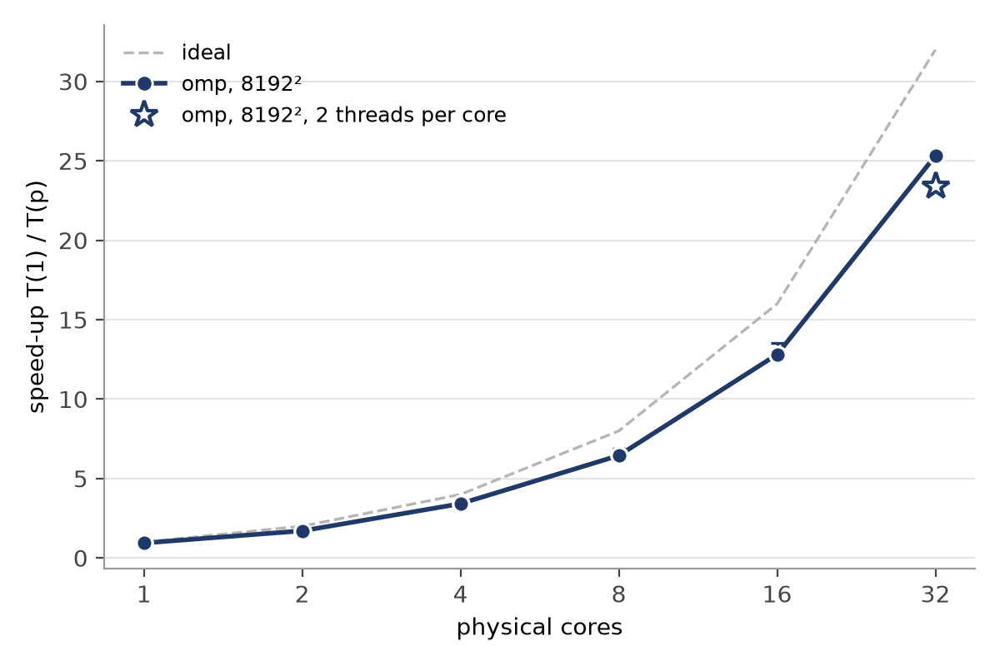
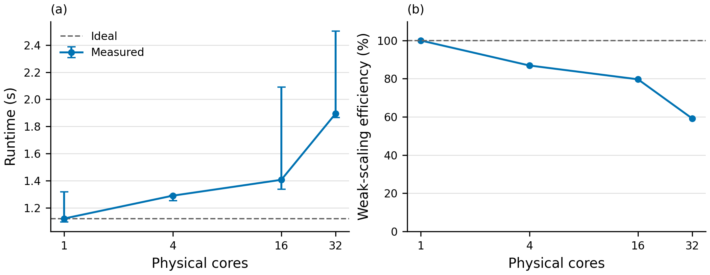

## 5. Results

Results are medians of three runs per configuration. Brackets and figure bars show the observed minimum and maximum.

<!-- E1, E2, STREAM and E6: ../results/tables/all.csv. E3: ../results/tables/e3_final.csv. E4: ../results/tables/e4_final.csv and ../results/tables/e4_final_runs.csv. E5: ../results/tables/e5_summary.csv. -->

**E1/E2 · Baseline and strong scaling.** The serial E1 baseline was **81.95 s** [80.69–82.11]. At 32 physical cores, OpenMP took **3.24 s** [3.23–3.25], a **25.3×** speed-up over E1 and **79%** efficiency. Using 64 threads on the same 32 cores raised runtime to 3.50 s [3.49–3.52]. Figure E2 shows the speed-up falling below ideal as the core count rises.

*Figure E2. OpenMP speed-up over E1. The star shows two threads per physical core.*

**STREAM/E6 · Bandwidth and grid size.** STREAM triad reached **68.0 GB/s** [67.4–68.0] on 32 physical cores. At 32 threads, the four E6 grids from 2048² to 16384² had median throughputs of 7,811–8,179 million cell updates/s, a spread of less than 5%. The sweep with fire spread disabled showed the same pattern. This suggests that memory bandwidth was not the main bottleneck in these runs.

**E3 · Hybrid split.** With 32 physical cores, the best one-node median was **2.694 s** [2.612–2.801] with 8 ranks and 4 threads per rank. For each fixed split, two nodes took **14.4–23.2% longer** than one. Median halo time rose for all three splits.

**E4 · Weak scaling.** With 1024² cells per physical core, runtime rose from **1.120 s** [1.096–1.316] on one core to **1.895 s** [1.867–2.505] on 32 cores. Figure E4 shows efficiency falling to **59.1%** at 32 cores. Each grid matched its own serial reference checksum.

*Figure E4. Median runtime and efficiency at fixed cells per core. Runtime bars show min–max, and dashed lines show ideal scaling.*

**E5 · MPI decomposition.** On one node with 32 ranks, blocks took **2.62 s** [2.58–2.85], versus **2.72 s** [2.62–2.76] for strips. At 32 ranks on two nodes, blocks still had the lower median within E5, at **4.56 s** [4.43–5.66] versus **4.98 s** [4.86–6.02]. On two nodes, both layouts spent about half the runtime in halo exchange, including time waiting for other ranks. E3 was a separate measurement campaign (§4).

<!-- Final layout: place each figure after its paragraph and number it in the assembled report. Use about half the text width for E2 and up to the text width for E4. These are two of the report's five figure slots. Keep E6 and E5 numerical here so the remaining slots can cover communication or optimisation and GPU results. -->
