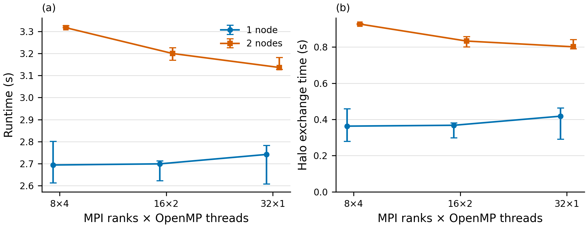
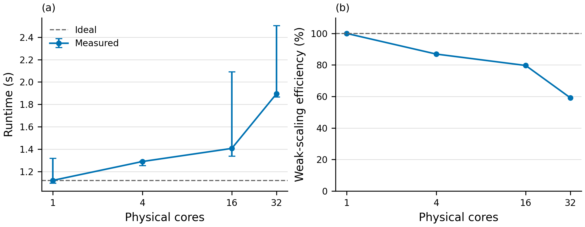

# Slide 3 · Hybrid performance and weak scaling

**E3 · One node won every split**

**E4 · 59% efficiency at 32 cores**

<!--
Speaker notes (about 40 seconds)

For E3, we kept the grid and the 32 cores fixed and changed how we split them between MPI and OpenMP. One node was faster for every split. The lowest one-node median was about 2.7 seconds. Time spent exchanging boundary cells and waiting for neighbors went up on two nodes.

For E4, we kept the number of cells per core fixed as we added cores. Ideally, runtime would stay flat. Instead, efficiency fell to 59 percent at 32 cores. Communication helps explain the later drop, but efficiency was already falling before any halo exchange.
-->
