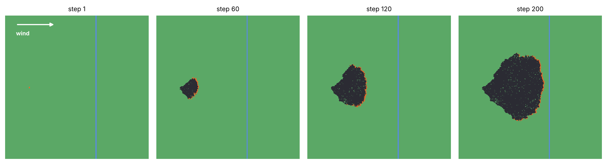

# Slide 1 · FireFront-HPC: a parallel wildfire-spread simulator

**Title line:** Simulating wildfire spread at 25 m resolution, fast enough for hundreds of scenarios

**Left column: the problem**
- Cellular automaton: each cell unburnt / burning / burnt, ignited by its 8 neighbours
- Spread depends on fuel, wind, slope and humidity
- 100 m → 25 m cells = 16× cells, ≈ 64× work; a forecast needs hundreds of weather scenarios

**Right column: our test case**
- 8192 × 8192 cells (205 × 205 km), 400 steps → 27 billion cell updates
- Serial baseline: **82 s** on one core (3.1 ns per update)
- Every parallel version must give the **same checksum** as serial, bit for bit

**Footer:** C11 · OpenMP · MPI · Slurm on SciTech (2 nodes, 32-core limit) · GPU experiment

<!--
Speaker notes (about 55 seconds; 5 slides in 5 minutes)

Our project is FireFront-HPC, a wildfire-spread simulator. Spain had one of its worst fire seasons in 2025, and forecasts are only useful if they are detailed and fast.

We model the landscape as a grid. Each cell is unburnt, burning or burnt, and a burning cell can ignite its eight neighbours, with a probability that depends on fuel, wind, slope and humidity. The picture shows our code: the fire runs downwind and stops at the river.

Why HPC? Going from 100-metre to 25-metre cells means 16 times more cells and about 64 times more work, and a real forecast needs hundreds of weather scenarios. Our test case is a 205-kilometre square at 25 metres: 67 million cells, 27 billion cell updates, 82 seconds on one core.

One rule ran through the whole project: every parallel version must reproduce the serial result exactly, checked with a checksum, before we time it. [Next: Sanad on how we parallelised it.]
-->
