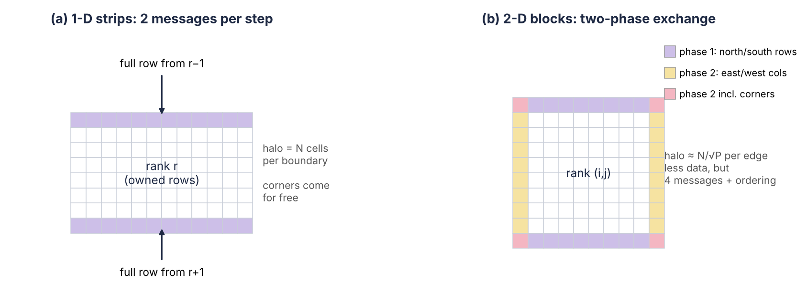

# Slide 2 · How we parallelised it

**Title line:** One C code base, from 1 core to 2 nodes, always the same result

**Left column: the layers**
- **OpenMP** inside a socket: threads over rows, pinned one per core, first-touch memory
- **MPI** across cores and nodes: grid split into strips or blocks (`MPI_Cart_create`), each rank owns its block plus a one-cell halo
- **Halo exchange** every step in two phases: rows, then columns, so corners arrive without diagonal messages
- **Hybrid:** threads inside each rank (E3), **GPU:** CUDA and OpenACC with the grid kept on the device (E10)

**Right column: what makes it trustworthy**
- Random numbers from (seed, global cell, step): any split gives the **same checksum**
- Every timed job checks `0xb8683c550fa95bd6` before its time counts
- Per-rank timers: halo, compute, reductions, imbalance
- **Result:** 32 MPI ranks on one node: **2.62 s, 31× serial**, efficiency 0.98

**Footer:** C11 · OpenMP · MPI (Open MPI 4.1.6) · CUDA · OpenACC · Slurm on SciTech
